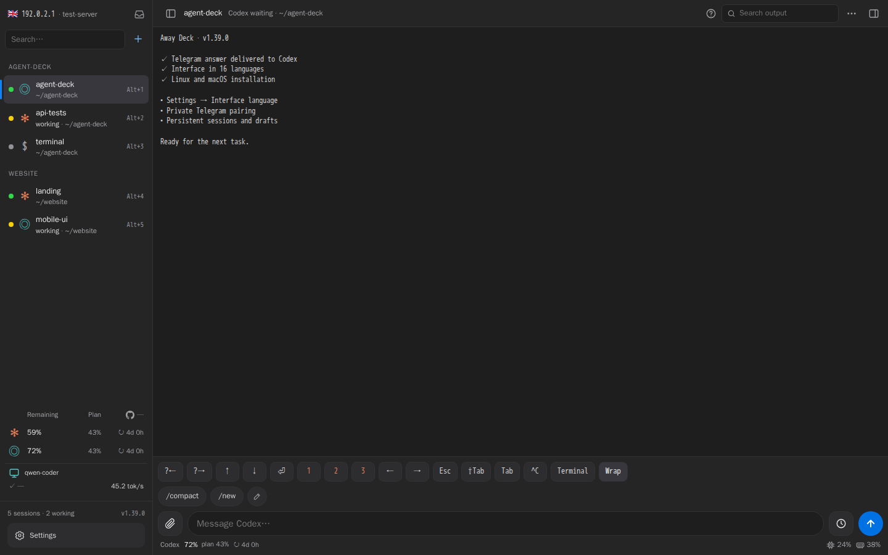
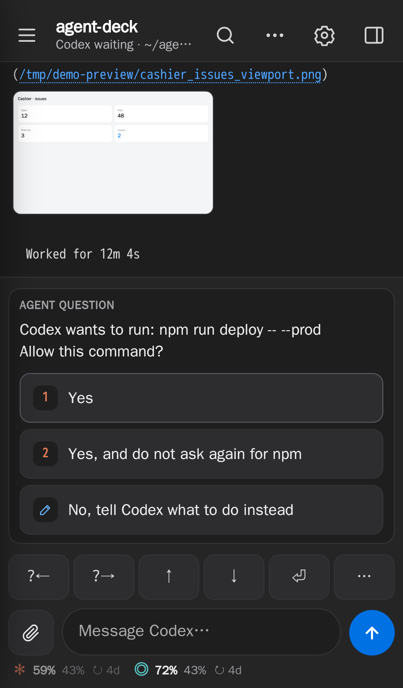
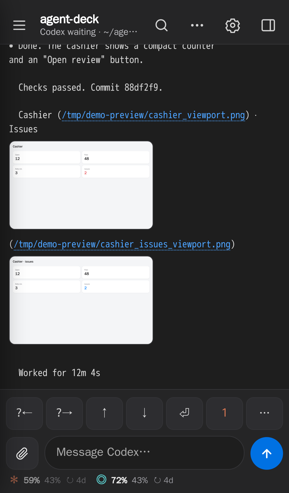
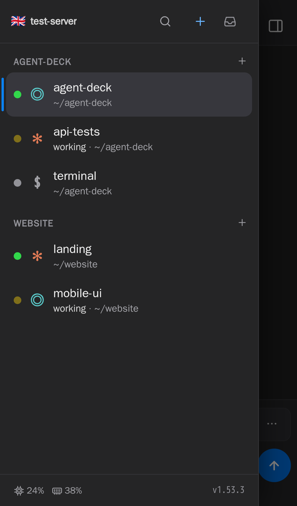
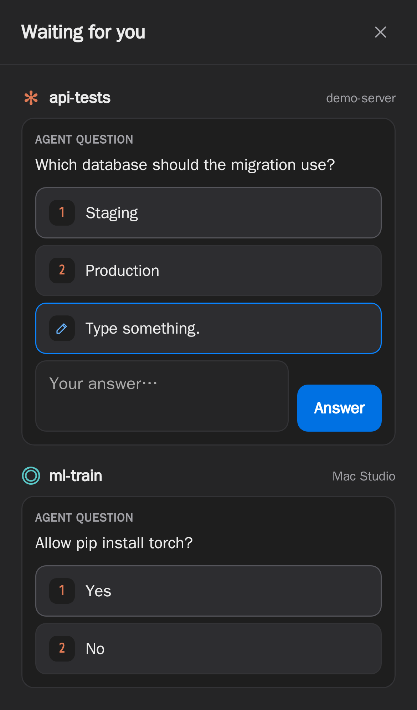
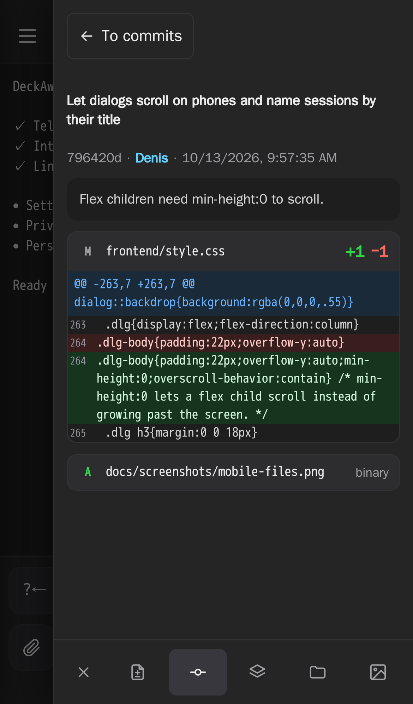
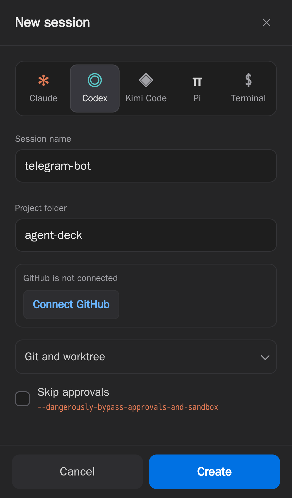

# DeckAway

**Your coding agents keep working. You check in from anywhere.**

Start a task at your desk, close the laptop, and answer the agent's next question from your phone with one
tap. DeckAway is a self-hosted page for [Claude Code](https://claude.com/claude-code),
[Codex](https://github.com/openai/codex), Cursor, Gemini CLI, Copilot and other agents running on your own
computers.

```bash
curl -fsSL https://raw.githubusercontent.com/matacoder/deckaway/main/get.sh | sudo bash
```

One command on a Linux server. [macOS, Windows, Docker, SteamOS](#install-anywhere) are one command too.



## Why

| Answer with one tap | See what the agent built | Everything in your pocket |
|:---:|:---:|:---:|
|  |  |  |

- **Nothing stops when you leave.** Sessions live in tmux on your machine. Close the tab, lose the connection, reboot: the agent is still there.
- **Agents ask, you answer in a tap.** A question arrives as a phone notification or a Telegram message with the answer buttons on it.
- **You see what was built.** Screenshots the agent made open inside its output; the diff, commits and files are one swipe away; "finished" says what was done in one sentence.
- **All your computers in one list.** A server, a laptop and a GPU workstation show as one workspace, and heavy `docker` runs can go to the strong machine.
- **Private by default.** Reachable only over your own [Tailscale](https://tailscale.com) network. No DeckAway account and no DeckAway cloud: the panel runs on your machine and talks only to the agents you installed.

## What is inside

| Waiting for you | Review on the go | Any agent, any model |
|:---:|:---:|:---:|
|  |  |  |

- **Agents:** Claude Code, Codex, Kimi Code, Cursor, Gemini CLI, GitHub Copilot, OpenCode, Qwen Code or a plain terminal, one per tab, grouped by project.
- **Models:** your subscriptions, any Anthropic-compatible service, or local models from LM Studio with no quota.
- **Limits at a glance:** what is left of each subscription and whether you are ahead of plan.
- **Send later:** hold a prompt until a set time, a free session or a limit reset.
- **Review:** changes, commits grouped by feature, a file browser with an editor; tap a line to comment on it for the agent.
- **Yours to keep:** encrypted backups of settings and sessions; 16 interface languages.

## Install anywhere

| Where | Command |
|---|---|
| **Linux server** (Ubuntu, Debian, Raspberry Pi OS 64-bit) | `curl -fsSL https://raw.githubusercontent.com/matacoder/deckaway/main/get.sh \| sudo bash` |
| **macOS**, without sudo | `curl -fsSL https://raw.githubusercontent.com/matacoder/deckaway/main/get.sh \| bash` |
| **Windows 11**, PowerShell as administrator | `irm https://raw.githubusercontent.com/matacoder/deckaway/main/install-windows.ps1 \| iex` |
| **Docker** | `git clone https://github.com/matacoder/deckaway.git && cd deckaway && docker compose up -d --build` |
| **SteamOS** | `git clone https://github.com/matacoder/deckaway.git ~/agent-deck && ~/agent-deck/install-steamos.sh` |

The installer prints the address, login and password. Then:

1. Open the address and log in.
2. Sign in to your agents in **Settings → Agents**.
3. On a phone, add the page to the Home Screen.

Your own domain with HTTPS, a Russian interface from the first launch, memory limits and the other options:
[Installing and updating](docs/install.md).

## Learn more

- [Using DeckAway](docs/guide.md): how it works, the phone, notifications, Telegram, the project panel, backups, security.
- [Agents, models and several computers](docs/agents-and-computers.md): LM Studio, other agents, connecting your machines into one list.
- [Installing and updating](docs/install.md): every platform in detail.
- [Architecture, troubleshooting, development](docs/DETAILS.md) · [Tests](docs/TESTING.md) · [Changelog](CHANGELOG.md)

**Security.** The panel gives a shell to whoever logs in. Keep the password private and prefer the default
Tailscale-only setup unless you need public access. [More](docs/guide.md#security)

[MIT](LICENSE)

<sub>Screenshots use demo data. Formerly Agent Deck: installed paths and service names keep the earlier name, so updates continue to work.</sub>
