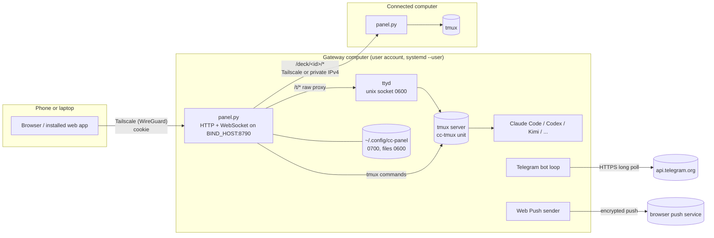

# Architecture

DeckAway is one small Python process per computer: a web page and a JSON API for tmux sessions, where coding
agents run. It does three things. It keeps agents alive when nobody is watching, it shows a person what an
agent is doing or asking, and it lets one computer, the *gateway*, show the sessions of several others.

## Design choices

| Choice | Why |
|---|---|
| **tmux is the source of truth.** A session is a tmux session `cc-<name>`; what it runs and its conversation are tmux options (`@cc_agent`, `@cc_sid`, …). | The panel can restart, update or crash without ending a single agent. A separate systemd unit (`cc-tmux`) owns the tmux server, and the panel only reads and drives it. |
| **Python standard library only**, plus one pinned, hash-checked wheel (`cryptography`, for backups and Web Push). | It installs on a Raspberry Pi, a Mac without Homebrew Python packages, WSL and SteamOS with no build step and no `pip`. Security updates never wait for a dependency tree. |
| **Vanilla JS, one generated HTML file.** `frontend/*` is bundled into `panel/index.html` by `scripts/build-panel.py`, and CI checks the bundle is current. | No bundler or runtime npm packages to keep patched. The in-panel updater validates and swaps one file, and browsers never mix the scripts of two versions. |
| **Services in `integrations/`, wiring in `panel/panel.py`.** No integration imports the panel; each gets its collaborators as callables (`Schedule(...)`, `Push(...)`). A test enforces both this rule and the `PACKAGES` list of the updater. | Each service is tested alone with fakes, and an installed updater knows every file a release may contain. |
| **Private by network, then by password.** The default bind is the machine's Tailscale address, and a signed cookie is needed on top. | The panel gives a shell to whoever logs in, so it must never be reachable by accident. |

## Components



- **`panel.py`** serves the page, `/api/*` (JSON), `/t/*` (a byte-for-byte proxy to ttyd for the terminal), and
  `/deck/<id>/*` (the same for a connected computer). It runs threaded; shared state is guarded by locks.
- **ttyd** listens on a unix socket only the user can open and runs `tmux attach -t cc-<name>`.
- **Background loops** in the panel: session persistence (every 5 s, recreates sessions after a reboot and
  resumes their conversations), the question scan for Telegram and notifications (every 2 s), limits,
  scheduled prompts, and polling of connected computers (in parallel, so one slow computer delays nobody).
- **Session hooks** (`panel/session_hook.py`, installed as Claude Code and Codex `SessionStart` hooks) record
  the top-level conversation id in `@cc_sid`, so a session can be resumed exactly. Nested agents are ignored.

## What a question goes through

```mermaid
sequenceDiagram
    participant Agent as Agent in tmux
    participant Panel as panel.py
    participant TG as Telegram
    participant You
    Agent->>Agent: shows a menu ("Do you want to proceed? 1. Yes 2. No")
    loop every 2 s
        Panel->>Agent: capture-pane, read the conversation file's tail
    end
    Panel->>Panel: parse_question: one numbered menu, one cursor, a footer; fingerprint
    Panel->>TG: message with one button per option
    You->>TG: tap "1. Yes"
    TG->>Panel: callback bound to owner, chat, message, session, question
    Panel->>Agent: screen still shows the same question? arrow keys, check again, Enter
```

The answer is typed only if the screen still shows the question that was sent. A changed screen, another
conversation in the pane, or a moved cursor fails closed and is never retried.

## Trust boundaries

| Boundary | What protects it |
|---|---|
| Network to panel | Bound to the Tailscale address by default (LAN and public HTTPS are separate opt-ins). Signed HMAC cookie; login rate limit per address and global; the login page never shows the account name. |
| Browser to mutation | Every POST and WebSocket upgrade checks `Origin`, and sibling origins are rejected. Logging out records the cookie's hash until it expires. |
| Panel to terminal | ttyd only on a 0600 unix socket. tmux input is sent as exact bytes, never through a shell. |
| Gateway to connected computer | Only numeric Tailscale or private IPv4 addresses. The saved password goes only to the Tailscale address the owner typed in. Any other address must first prove a pair key bound to the address that was dialled. Gateway cookies are never forwarded. |
| Agent output to browser | Pictures are served only if their path is on that session's screen, checked by content (PNG/JPEG/WebP/GIF), with `nosniff` and `CSP: sandbox`. Isolated terminals are served under `CSP: sandbox` without `allow-same-origin`. |
| Root to user | The installer runs as root but writes under the user's home only as that user, and refuses a source tree owned by that user, writable by a group, or reached through a symlink. The panel and its updater never run as root. |
| Secrets at rest | `~/.config/cc-panel` is 0700, every secret 0600, written atomically through one helper (`integrations/private_files.py`). Secrets never go into logs, URLs, JSON answers or tmux command lines. Logged failures carry the place and type of an error, never its text. |

## Updates

`panel/updater.py` downloads a tagged release and checks that it holds exactly the expected files (`PACKAGES`).
It compiles and imports the new code before stopping anything, swaps the files, and writes `VERSION` last.
If the new panel does not answer, the old files come back. Installed paths and units keep their names across
versions (`/opt/cc-panel`, `cc-*.service`, `~/.config/cc-panel`); changing that layout needs a major version
and a migration.

## Names

| Name | Where |
|---|---|
| DeckAway | the product, the repository `matacoder/deckaway`, the interface |
| Agent Deck | the earlier name: `/opt/agent-deck` (the root-owned checkout), `/etc/agent-deck`, `~/.cache/agent-deck` |
| cc-panel | installed code `/opt/cc-panel`, settings `~/.config/cc-panel`, units `cc-panel`, `cc-ttyd`, `cc-tmux` |

The installed names are kept on purpose: renaming them would break every existing installation's updates.

## Where to read next

- [AGENTS.md](../AGENTS.md): the module map and the rules every change keeps.
- [DETAILS.md](DETAILS.md): persistence, publishing, troubleshooting.
- [integrations.md](integrations.md): Telegram, LM Studio, GitHub.
- [TESTING.md](TESTING.md): what is tested and how.
