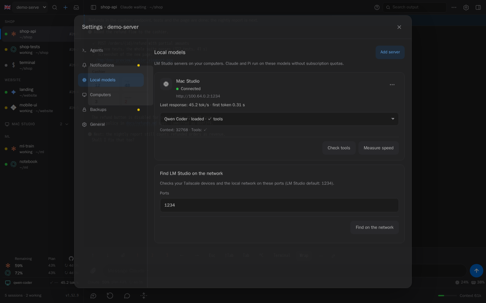
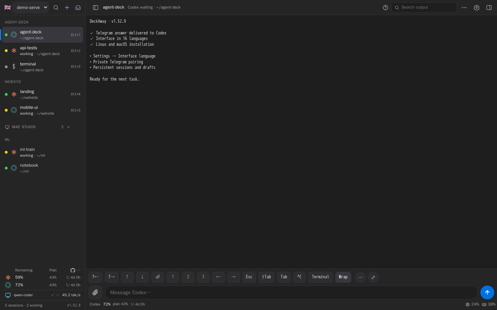

# Agents, models and several computers

[← Back to the overview](../README.md)

## LM Studio Connector

1. Enable the LM Studio server on the machine hosting your model, with its
   Anthropic-compatible `/v1/messages` API reachable over your tailnet.
2. Open **Settings → Models**. Choose **Find on the network** to probe known Tailscale
   peers and the local network on port 1234, or enter comma-separated custom ports. This checks addresses
   returned by `tailscale status --json` and the 253 neighbours of this computer's local address
   (its `/24`); a server found both ways is listed once, under its Tailscale address.
3. Add a discovered server, or use **Add server** with a custom HTTP/HTTPS URL
   and optional API key. Saving checks the connection and lists available models.
4. **Test tools** explicitly verifies a synthetic tool call. **Measure speed**
   runs a small synthetic benchmark; neither test sends an existing conversation.
5. In **New session**, select **Claude** and the local server/model as its source.
   Install Claude Code under **Settings → Agents** if needed.

The selected server and model are pinned to the session, including restarts and
recovery. A missing profile or binding leaves a shell; it never falls back to a
cloud provider. Add a separate profile to change servers while sessions use the
original one. API keys can be rotated without changing the pinned address.

Local models have no subscription quota cards. The panel reports observed
streaming tokens/s and time to first token from real session responses when the
server provides token usage. Native benchmark results are stored separately.
Context length and loaded state come from the model API. Missing GPU, RAM or
other hardware statistics are not estimated. Small context windows and models
without tool support may be unsuitable for coding-agent workloads.

Claude Code started against a local model receives a compact tool set (shell,
files, search, questions and plan mode) instead of roughly 30k tokens of
Anthropic-only tool schemas on every request. Its auto-compact window is the
context length LM Studio reports for the loaded model at launch, or the value
from the last profile check when the server does not answer. Reload the model
with a different context length, then restart the session to apply it.

Profiles and keys live in `~/.config/cc-panel/integrations/lmstudio.json` (0600).
`model-bindings.json` stores private session bindings and `model-relay.json` stores
loopback relay credentials. A local authenticated relay forwards requests to the
pinned server and records timing/usage only; it does not store conversation text.
An in-progress local-model request may need retrying when the panel service updates.

## Multiple DeckAway instances

Use **Settings → Network → Other DeckAway instances** on the server whose
web address you normally open. Click **Discover** to search online Tailscale peers
on port 8790 (or a custom port), or enter a remote `http://100.x.y.z:8790` URL.
Provide that instance's panel login and password, then connect. Select the instance
in the sidebar (the switcher appears once an instance is connected), or tap any of its
sessions: the sidebar lists the sessions of every connected computer under its name, so
switching environments is one tap and happens in place, without reloading the page. Manage its sessions, files, models and live terminal through the
gateway. Your browser does not need direct access to the remote Tailscale address.
The gateway and remote computer must both be connected to the tailnet, or sit in the same local network
(below).

**This computer.** When the browser runs on one of the connected computers, that computer is marked
"this computer" in the list and in the bottom line of a session: you are looking at it through the gateway,
but it is the machine under your hands. The page asks `127.0.0.1` one question (is the installation with
this id here?) and a panel answers it only for its own id. It is asked on a desktop with more than one
computer; Chrome may ask once for permission to reach the local network. Safari does not let a page ask
that question at all: there, open **Settings → Network**, the **⋯** of the computer, **The browser runs on
this computer** — it is remembered in that browser.

**Open directly.** With a connected computer selected, the arrow button beside the computer list opens that
computer's own panel in a new tab, at its Tailscale address and already signed in: nothing then travels
through the gateway and the internet in between, which is what you want on the machine under your hands. It
works from any device that reaches that address. The link signs in once and within a minute; the secret in
it is given by the computer to the gateway, never to a page, and is removed from the address bar before it
is spent. A browser cannot make this shortcut silently from the gateway's own https page — pages served over
https may not call plain-http addresses — which is why it is a separate tab.

**Local network.** Tailscale is not required between computers of one home or office network. In
**Settings → Computers → Local network** switch on the computers that should also answer at their ordinary
local address (`192.168.x`, `10.x`, `172.16–31.x`); the gateway can switch it for every connected computer.
It is off by default, and each switch asks first: the connection there is plain HTTP, so the panel password
and the contents of sessions cross that network unencrypted. Turn it on only in a network you trust. A
computer installed without Tailscale (`BIND_HOST=<its local address>`) answers there already.

- **Find on the network** searches Tailscale peers and the neighbours of the gateway's local address. A
  computer seen in both networks is one row with both addresses, and it is connected once.
- A connected computer is reached over Tailscale first; when that does not answer, the gateway uses its local
  address, and the row says so. A request that was already sent is never repeated on the other address.
- The saved password goes by itself only to the Tailscale address you entered. Any other address must first
  prove a key the two panels agreed on while signed in, so the same `192.168.x` address in a café's network
  gets neither the password nor the session cookie. Connecting a computer by a local address sends its
  password there once, when you press **Connect**.
- The search covers the `/24` around the gateway's address. Larger or routed networks: add the address by
  hand. WSL2 without mirrored networking has no address in the real local network.

Credentials remain in a private file on the gateway. Existing remote DeckAway
1.0.7 instances can be connected; only the gateway needs the new UI. Connection
settings always belong to the gateway; session and project settings belong to the
currently selected instance. Switching preserves separate drafts on each machine.

**Update all computers.** The same card shows each computer's version; an arrow marks computers behind
the latest release (also in the sidebar). **Update all** updates every connected computer through the
gateway, then the gateway itself; panels restart one by one and sessions keep running.

**Network and panel address** shows the listening address and browser address and
lets you name the gateway and record its public URL. Recording a URL does not
create DNS records, provision HTTPS or change the reverse proxy. Public hosting
is configured using the installer's `PUBLIC_DOMAIN` and proxy options.

New installs use `~/dev`. Existing explicit project directories are retained;
older default `~/projects` settings pick up `~/dev` when that directory exists.

## Cursor, Gemini CLI, GitHub Copilot, OpenCode, Qwen Code

Each is installed from **Settings → Agents** with its vendor's own command and, once installed, appears in
the new session dialog. **Sign in** opens the program's own sign-in in a terminal; the panel never reads
its key. A restart continues the session's conversation (OpenCode makes its own ids, so it continues the
last conversation of the folder). `/compact` (or the program's name for it) and "new conversation" sit
behind the **…** chip. Context size, summaries and subscription limits are not shown for these agents yet,
so their sessions have no bottom status line.

| Agent | Without questions | Sign-in |
| --- | --- | --- |
| Cursor (`cursor-agent`) | `--force` | Cursor account, in a browser |
| Gemini CLI | `--yolo` | Google account or API key, inside the program |
| GitHub Copilot CLI | `--allow-all` | the GitHub CLI sign-in, or `copilot login` |
| OpenCode | `--auto` | optional: `opencode auth login` |
| Qwen Code | `--yolo` | `/auth` and `/model` inside the program |

## Claude Code on other models (GLM and others)

**Settings → Agents → Claude on other models** saves a service that speaks Anthropic's API: a name, an
`https://` address, a key and a model. **Add GLM** fills in Z.AI's address; the model name is the one your
plan there has. A new **Claude** session then offers the service under **Model source**. The key is kept
in `~/.config/cc-panel/providers.json` (0600) and reaches Claude Code only through its environment.
Summaries are not written for such sessions: the conversation is not sent to any other model.

## Claude Code as the lead

A Claude Code or Codex session started by the panel is told, in one line, which other agents on this
computer take a task in one command (`codex exec`, `gemini -p`, `cursor-agent -p`, `copilot -p`,
`opencode run`, `qwen -p`) — only those installed and signed in. Ask it for a second opinion or to hand a
task over, and it runs that agent in the project folder and reads the answer.

## Kimi Code

Open **Settings → Models → Kimi → Configure**. Save a Kimi Code API key
and choose a model. Create a session with **Claude Code** and a **Kimi** model source (the Anthropic-compatible endpoint), or choose **Kimi Code** for the native CLI. Install Claude or Kimi
under **Settings → Agents** if needed. An existing `~/.config/cc-kimi/env` key is detected automatically.
Claude through Kimi uses the compact tool set described for local models plus
subagents, web fetch and skills, and compacts at the model's real window (1M for K3).

The key stays on the server in a private file; API responses and tmux commands do not contain it.
Leaving the password field empty preserves the key; **Remove key** removes it from the panel.
The model setting is the default for new native Kimi sessions; existing sessions keep their selected model. Key changes apply on the next agent launch. Native sessions/configuration use
`~/.config/cc-panel/kimi-native/`, preserving the user's independent Kimi configuration.

Kimi quota cards show the account’s returned monthly total/coding and short-period limits,
with reset dates. Monthly windows do not assume a fixed 30-day duration for pace forecasts.

Installed DeckAway panels automatically check stable releases every 30 minutes.
Disable this in **Settings → App → Automatically update DeckAway** if desired.
**Check for updates** bypasses the cached release check. Updates preserve tmux
sessions, wait for active local-model requests, and roll back after a failed health check.
Development git checkouts remain excluded. Existing versions need one update to
1.2.0 or later to enable the background updater.
