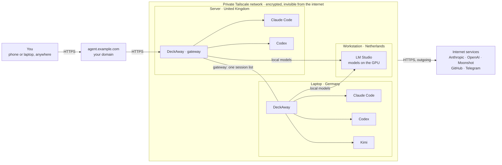

# Using DeckAway

[← Back to the overview](../README.md)

## How it works

**Tailscale** is a private encrypted network between your own devices: the computers see each other wherever
they are (different countries are fine), and nobody on the internet sees them. Your domain leads to one
computer running DeckAway as the **gateway**; the other computers run their own DeckAway and agents and
connect to it inside the network, so all their sessions show in one list. Any computer can serve LM Studio
models to the others.

The agents run on your own computers, in your project folders, exactly as if you had opened a terminal
there. The browser is only a window onto them: close it and the work goes on; open it on a phone and you
see the same sessions. Nothing is exposed to the internet — the phone reaches the computer over
Tailscale. On Linux, when the computer runs out of memory, only the process the kernel kills ends (say, the
agent); its session and tab stay, and the agent can be started again in it.

**Checking results while away from the computer:**

- Agents send screenshots of what they built; the pictures open right in the session output.
- A site an agent starts (a dev server) opens in the phone's browser at the computer's Tailscale address.
- Changes, commits, files and the gallery are in the panel on the right (on a phone it slides in from the right edge); tap a changed
  line to comment on it in your next message.

The **?** next to the search field in the session bar shows the same picture inside the panel.

## Features

**Agents and sessions**

- Claude Code, Codex, Kimi Code, Cursor, Gemini CLI, GitHub Copilot, OpenCode, Qwen Code or a plain terminal — one per tab, grouped by project, with "working / waiting / done" at a glance.
- Claude Code on other models: Kimi, GLM or any Anthropic-compatible service, and local models from LM Studio with speed measurements and no subscription quota.
- A **+** on each computer and project starts a session there; pick a GitHub repository and go, optionally with a git worktree per session (one branch per agent).
- The **⋯** menu restarts an agent with a new or the same conversation, duplicates, renames or closes a session. Sessions come back after a reboot.

**Staying in the loop**

- **Waiting for you:** one list of every agent question and finished session on all computers, answerable in place.
- Notifications on phone and desktop when an agent asks or finishes; a "finished" notification says what was done.
- Telegram bot: questions with answer buttons and "finished" messages in your private chat; reply to send the next prompt.
- A one-line summary of each conversation and how full its context is.
- The conversation itself, readable after a restart or a compaction left only a few screens in the terminal.
- Subscription limits (what is left and the even-spending plan) in one line under the message field; on a narrow screen the ones that do not fit fold behind "…".

**Seeing the work**

- Screenshots an agent mentions by path appear as thumbnails under the line and open full screen; a gallery keeps every picture a session showed.
- Changes, commits and files in a side panel: tap a line of the diff to comment on it in your next message.
- **Feature groups:** a model sorts the commit history into features in the background, each with a combined diff.
- Project files: browse, edit text, read Markdown rendered, preview images and PDF.
- Search the whole output of a session, scrollback included; quick switcher with Alt+K, Ctrl+K or ⌘K.

**Getting things to the agent**

- Drop files onto the window or paste messages copied from a chat (Telegram included): the text goes into the field and its pictures are attached. After a paste by the menu on a phone, **Paste with pictures** in **⋯** takes them. A picture its site does not let a page read is fetched by the panel itself — only from a public https address, never from your network.
- **Quick prompts:** your own messages and the agent's `/compact` and `/clear` as one-tap buttons.
- **Send later:** hold a message until a set time, until the agent is free, or until the limit resets; a session can also continue by itself after a limit.
- Attachments up to 200 MB with upload progress.

**Several computers**

- Connect other DeckAway installs to one gateway: one session list, one inbox, one set of notifications.
- **Containers on another computer:** keep agents on a weak machine and run their `docker` and `docker compose` on a strong one; no SSH, no keys.
- **Open directly:** on the computer you are sitting at, one button opens its own panel straight over Tailscale, signed in, without the trip through the gateway.
- Works in an ordinary local network next to Tailscale, when you switch that on.

**Everyday comfort**

- Built for phones first (home-screen app, portrait and landscape) and fast on a desktop: the page opens with what it showed last time and replaces it as fresh answers arrive, switching sessions shows the screen at once, and terminals of recent sessions are connected ahead.
- One Settings hub with a getting-started checklist; in-panel agent install and sign-in.
- Encrypted backups of settings between your computers; panel updates by themselves.
- UI in 16 languages.

## Phone

**iPhone / iPad.** Open the panel in Safari, tap **Share → Add to Home Screen**, then always start it
from the icon. It runs full screen, keeps drafts and supports one-tap answers to agent questions.

**Android.** Open the panel in Chrome, tap **⋮ → Add to Home screen** (or **Install app**).

Sessions are in the menu (☰); its badge counts what is waiting for you. Under the session bar a quiet line
says what the conversation is about (its headline; tap it for the rest); at the bottom
are the **new conversation** and **restart** buttons, how long the conversation has been running and a short
bar showing how full the context is. Files are uploaded as a raw stream with
progress, so a large video does not have to fit into the phone's browser memory twice.

## Session summary and context

For Claude Code (also on Kimi or LM Studio) and Codex sessions the panel reads the agent's own conversation
file. The bar at the bottom shows how many tokens the latest request carried: green while the conversation
is fresh, orange from 80k (the agent starts losing details), red from 150k (time for a new conversation);
both limits are set in **Settings → General** for this browser;
Codex also shows its context window. The clock before the bar is the time since the first record of the
conversation file: a long conversation has drifted from its start even when compaction keeps it small. The summary under the session bar is written by a model of the same
provider as the session, so the conversation goes nowhere new: Claude Haiku for Claude on the subscription,
Codex's light model for Codex, Kimi for Claude on Kimi, the same local model for LM Studio. It is rewritten
in the background at most every 5 minutes, only while the session is open and only after it changed, and
kept in `~/.cache/agent-deck/summaries/`.

The same answer names the session: a short name in Latin letters such as `fix-payment-webhook`, kept until the
work moves to another task and shown in the list, the bar and notifications instead of the name the session
was created with. A session you renamed yourself keeps your name; **Settings → General → Session names** turns
this off for a computer's sessions.

The **Conversation** button next to the bar (also in the **⋯** menu) opens what was said in that file: your
messages and the agent's answers, without tool output. A terminal keeps only what was printed since the agent
started, and a restarted or compacted conversation prints little; the file still has the rest, including what
came before a compaction.

## Waiting for you

The **Waiting for you** button in the sidebar lists every agent
question and every session that finished work, on all connected computers. Answer a question with one
tap right there; options such as *Other* or *Type something* open a text field and send your own answer.
Tap a session name to open it, on the right computer.

## Quick prompts and sending later

The row of buttons above the message field sends a message with one tap: your own saved prompts
first, then a three-dots button that shows the commands of the open agent (`/compact` and `/clear` for
Claude, `/compact` and `/new` for Codex). Commands that drop the conversation ask before they are sent. The pencil at the end of the
row edits your prompts (up to 24); the list is kept on the DeckAway you open in the browser and is the
same for every connected computer.

**Send later** in the three-dots menu of a session holds a message for later (while something waits, a
clock with the count also sits next to the send button):

- **When the agent is free:** sent once the session has been quiet for a few seconds. Several such
  messages go one at a time, each after the previous one is done.
- **When the limit resets:** sent after the subscription limit that stopped the session has reset.
- **At a set time:** sent at that time, within the next 30 days.

The same dialog lists the messages still waiting (each can be removed) and has the
**Continue after the limit resets** switch: when the agent stops with a limit notice, the panel reads
the reset time from the notice (or from the provider's counters when the notice names none), waits a
minute past it and sends `continue`, once per notice: the same notice left on an idle screen is not
answered again the next day or after a panel restart. It is off by default and set per session.

A waiting message is never typed while an agent question is open in the session, because it would be
taken as the answer; it goes as soon as the question is closed. Each message is sent at most once: if
the panel cannot confirm it, the dialog says so and nothing is repeated. Messages wait on the computer
that runs the session, in `~/.config/cc-panel/integrations/schedule.json`, and survive a panel restart;
closing a session removes its waiting messages. Attachments cannot be held for later.

## Containers on another computer

Agents can run on one computer while their containers run on another: for example a small server
that is always on, and a strong desktop that builds images and runs test stacks.

1. Connect the computers in **Settings → Computers** (each runs its own DeckAway).
2. In the **Containers** card, switch on the computers that may run containers. A Docker that is installed
   but closed is opened by the panel, then and whenever a command arrives (Docker Desktop, OrbStack, Colima,
   rootless Docker); "Docker not found" means it has to be installed or started by hand.
3. Choose one of them when you create a session (**Containers** in the new-session dialog), or later at the
   bottom of the status bar, which names the session's computer on the left and its containers' computer on the right. **Default for new sessions** in the same card presets that choice.

From the next new or restarted agent session, `docker` and `docker compose` in that session talk to
the chosen computer's Docker. The commands do not change, and there is nothing to configure between
the machines: the panels pass the connection over Tailscale with the login they already have. The
agent is told at the start of the session where its containers run. Each marked computer also gets
a Docker context named after it, for use by hand: `docker --context red ps`.

What is different from local Docker:

- **Local folders are not there.** A bind mount of a folder on the session's computer
  (`-v ./src:/app`, compose `volumes: - ./src:/app`) does not work. Put the code into the image with
  `COPY`, use named volumes, `docker cp` or `docker compose watch`.
- **Ports open on the other computer.** A container published on port 5432 is reached at that
  computer's Tailscale address, not at `localhost`.
- **A sleeping computer runs nothing.** The Docker command then says which computer does not answer;
  it never falls back to the local machine silently.
- Marking a computer gives every DeckAway connected to it full control of its Docker. Only the
  computer the others are connected to can send its containers elsewhere in this version.

## Project panel: changes, commits, files

Changes, Commits, Feature groups, Files and Gallery share one panel with five tabs. On a wide screen it is
a sidebar on the right: the sidebar button at the right end of the session bar (like the one on the left)
shows and hides it, it stays open while you switch sessions (showing the open session's project) and is
remembered in this browser. Drag the inner edge of either sidebar to change its width (double click for the
default). On a phone it is a drawer like the menu, mirrored: swipe from the right edge or tap the sidebar
button at the top right; swipe it back or tap beside it to close. The phone's session bar keeps only search,
**⋯** and that button. In the drawer the tabs sit at the bottom, under the thumb, and code shows one narrow
line-number column; the code font size is in **Settings → General** (a wide screen also has A−/A+ in the panel). **Changes** shows what is not committed yet, or the last commit when the tree is clean.
With several git worktrees the panel shows the one the agent last named in its output (its path or branch),
marked "auto"; the picker next to the repository name chooses another.

## Project files

The **Files** tab of the project panel browses the session's folder and everything else in your home folder. Text files
up to 1 MB (including `.env`) open in an editor: copy from them, paste a secret in and save, or create a
new file — new files are private (`0600`), existing ones keep their permissions, and a file that changed
on disk after you opened it is never overwritten. The panel's own settings folder (`~/.config/cc-panel`)
is not shown. Any file can be downloaded, up to 40 MB, with the button at the end of its row in the list
(no need to open it) or from the open file. On an iPhone or iPad with the panel on the Home Screen the file is offered through the share sheet
(**Save to Files**), because such an app has no downloads. Works for
sessions on connected computers too.

## Change history

The **Commits** tab of the project panel shows the commits of the session's repository: subject, author, time and line
counts; tap one for its full message and a diff per file with line numbers.

The **Feature groups** tab is always ready: the panel sorts new commits into features in the background, a
few at a time, so nothing has to be started or waited for. On top, **Now** shows who works on what: each
author with a commit in the last 7 days and the feature of their latest commit (Denis on the terminal
security, Pasha on the booking card). Commits the model has not sorted yet are listed as plain commits, then
the groups with their summary, authors, commit count and combined diff collected per file.

- Every 5 minutes the panel looks at the repositories of this computer's sessions (all worktrees share one
  history) and quietly fetches them every 15 minutes, so a collaborator's pushed branches show up by themselves.
- A pass starts when the newest new commit is 10 minutes old (an agent committing in a row is sorted once)
  or 20 commits wait; **Sort now** skips the wait. It sends only the existing group titles and up to 40 new
  commits: subject, author and file names, never code.
- Models, tried in this order: Claude Haiku (`claude -p`, no tools) and Codex's light model (`codex exec`,
  read-only sandbox without network) on your subscription, then Kimi with a saved key, then the first
  LM Studio model. Both CLIs run in an empty temporary folder; the answer only places real commits.

 

## Screenshots from agents

When an agent prints the path of a PNG, JPEG, WebP or GIF file — absolute, `~/…` or relative to the
session folder, even if the terminal wrapped it across lines — the **Screen** view turns the path into a
link and shows a thumbnail under that line. Tap it for a full-screen viewer: swipe or use ←/→ between
screenshots of the same screen, **Open original** for full size. A file is served only while its path is
visible in that session's recent output, only as a real raster image (never SVG), up to 25 MB.
Thumbnails are scaled down to 480 px with `sips` on macOS or ImageMagick on Linux when available
(cached until the file changes); otherwise the original image is used.

Every picture a session showed is also kept in its **Gallery** (the picture icon in the project panel):
square thumbnails, newest first, opening in the same viewer. The panel copies each picture when it appears
(`~/.cache/agent-deck/gallery`, private), so it stays after the path scrolls away, the agent overwrites
`/tmp/shot.png` with a new one or deletes the file; the Screen view falls back to that copy too. Up to 200
pictures and 300 MB per session, each kept for 30 days.

Claude and Codex sessions started from the panel are asked to show a finished task on their own: screenshots
of the result and, for anything that opens in a browser, a link on this computer's Tailscale address rather
than `localhost`. **Settings → General → Finished task** turns the request off; it reaches a session at its
next start or restart.

Paths to other files with a folder in them (`/home/me/trip/plan.pdf`, `src/app.py`) are links too: a tap
downloads the file, with the same rules as Project files (inside your home folder, never the panel's
settings, up to 40 MB).

## Notifications

Agent questions and finished work from **every connected DeckAway** arrive as system notifications
on your phone or computer, even when the panel is closed. Tapping one opens that session, on the right
computer. No account with Apple or Google is needed: the panel signs notifications with its own key and
encrypts them for your device, so the push service only relays ciphertext.

Requirements:

- The panel is opened over **HTTPS** (see the `PUBLIC_DOMAIN` install option). Browsers do not allow
  notifications on plain `http://100.x.y.z:8790` addresses. Only the DeckAway you open in the browser
  needs HTTPS: it watches the connected computers and sends notifications for all of them.
- **iPhone / iPad:** iOS 16.4 or newer, panel added to the Home Screen and opened from its icon.
- **Android, Mac, Windows, Linux:** a current Chrome, Edge, Firefox or Safari.

Turn on: **Settings → Connections → Notifications → Turn on notifications**, allow the browser prompt.
A test notification arrives right away. Choose the events (agent questions, agent finished) with the
switches; each device can be turned off there or removed from any other device. On iPhone the app icon
also shows the number of sessions that finished.

## Telegram

Receive questions from Codex and Claude in your bot's private chat and answer by
tapping a button. Codex questions can arrive while the agent continues working;
the panel opens the queued question, selects your answer and confirms it in the
correct session. Claude through Kimi uses the same Claude adapter; native Kimi uses
recognized active terminal menus. Custom text and multiple selections use the panel.

1. Open **Settings → Connections → Telegram → Configure** on desktop or phone.
2. Paste your existing bot token from [@BotFather](https://t.me/BotFather) and save.
3. Follow **Pair my Telegram** and press **Start** in the bot's private chat.
4. Answer a question using its buttons. The bot confirms when the answer reaches the agent. For a
   custom answer (*Other* / *Type something*), reply to the question message with your text.

The bot also says when an agent finishes working (the same event as the "finished" notification). With
notifications on a device as well, each event is told once: Telegram gets the questions and the finished work
that waits for your answer or approval, a notification the rest. Without subscribed devices, or when no
device's push service accepted a notification, Telegram gets it instead.
Both carry the session's summary, rewritten at that moment by a model of the session's own provider:
what the goal was, what is done and what is next. It can take up to 30 seconds to arrive.
Reply to that message with text and it is sent to that session as the next prompt, on whichever
connected computer it runs; the bot confirms it. A reply is refused when the session was closed or has
an open question. The **Tell me when an agent finishes** switch in the Telegram card turns these
messages off.

The pairing link contains a one-time code and expires after ten minutes. The panel
gets the administrator's user/chat IDs from that authorized `/start` message;
an ordinary `/start` does not grant access. Only the paired account can answer.
Pause delivery with the switch or remove the token from the integration card.
Use a dedicated bot without another polling consumer or webhook. No public server
address, webhook endpoint or extra dependency is needed.

**Several computers, one bot.** Telegram delivers button taps to a single receiver,
so configure the bot only on the DeckAway you open in the browser and connect the
others in **Settings → Network → Other DeckAway instances**. Their questions arrive
in the same bot, labelled with the computer name, and answers are relayed back through
the authenticated gateway. Leave Telegram off on the connected computers: if the same bot is
still on there, Settings warns and offers **Turn off on <computer>** right in the Telegram card,
whose **⋯** menu also disconnects the bot here.

Settings stay in JSON files. Telegram credentials and pairing are in
`~/.config/cc-panel/integrations/telegram.json`; the durable question outbox is in
`questions.sqlite3` alongside it. Both files are private (`600`), and SQLite needs
no database server. Tokens are never returned to the browser or committed to git.
Answers are protected against stale buttons, repeated clicks and uncertain replays
after a restart. See [integration setup and architecture](integrations.md).

## Backups

**Settings → Backups** protects DeckAway settings, integration keys (Telegram, Kimi,
LM Studio, connected computers) and agent logins (`~/.codex/auth.json`,
`~/.claude/.credentials.json` on Linux, `~/.config/gh/hosts.yml`). The panel login and
password are set by the installer and are not part of a backup. On macOS the Claude login is read
from and restored to the Keychain, so no plaintext copy is written.

1. Click **Turn on backups** and store the recovery code (`AD1-…`) in a password manager.
   It is shown once; without it a backup cannot be decrypted on a new computer.
2. The DeckAway you open in the browser gives the same key to every connected
   computer, backs up each of them daily (and on **Back up now**) and keeps every copy on
   every other computer. Each computer keeps its last 14 copies per machine.
3. To replace a dead computer, install DeckAway on the new one, connect it under
   **Settings → Network**, then pick its backup and **Restore to** the new computer. To
   rebuild the main computer, connect any surviving one, choose it as the copy source,
   enter the recovery code and restore. **Download this machine's backup** gives an
   offline `.adbk` file for **Restore from file**.

Backups are encrypted with AES-256-GCM (`cryptography`), so other computers only hold
ciphertext; backups made by 1.5.0 remain restorable. Restoring first backs up the state it replaces, writes files only to their
known locations with `600` permissions and restarts the panel; tmux sessions keep running.

## Security

The panel gives a shell to whoever logs in. On Ubuntu it runs as the dedicated unprivileged
user (with rootless Docker); on macOS it runs as your logged-in Mac user. Keep the password private, and prefer the default Tailscale-only setup unless you need public
access. Answering in the local network is a separate switch per computer, off by default: there the
connection is not encrypted.

A sign-in lasts 90 days. Logging out ends that browser's sign-in at once, also any copy of its cookie;
other devices stay signed in. Changing the password ends every sign-in. The login page never shows the
account name.
